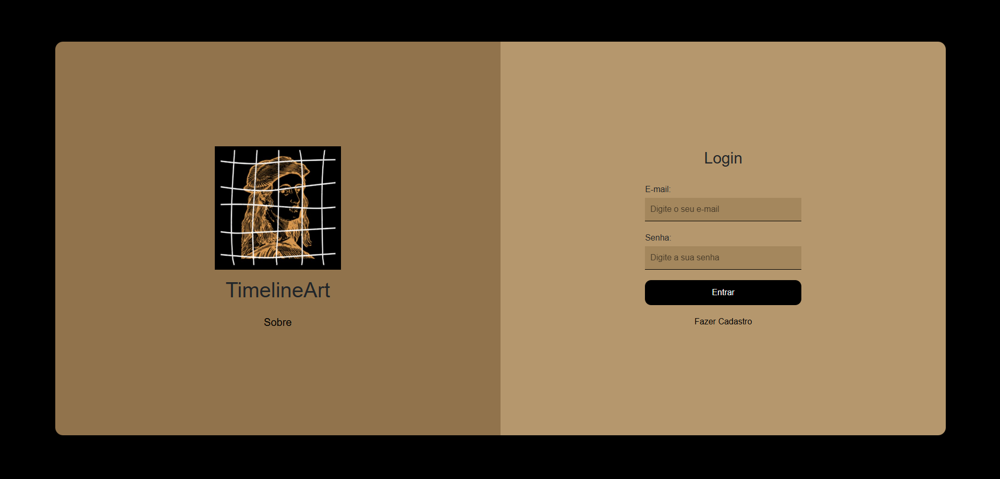
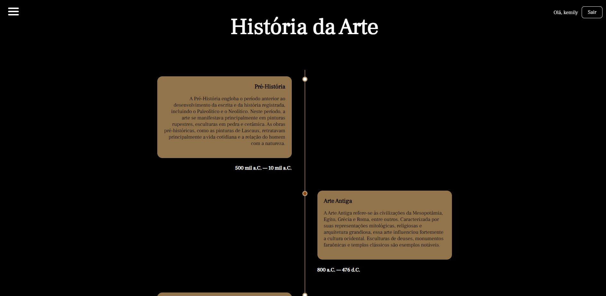
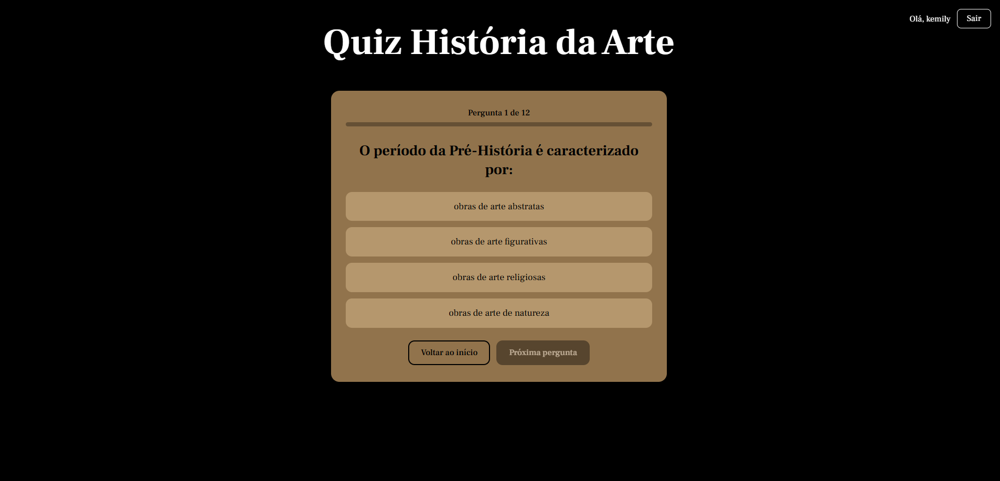

# TimelineArt – História da Arte

O **TimelineArt** é um site de estudos sobre a história da arte. Inicialmente ele tem o conteúdo e, logo após, um quiz, para que o usuário possa testar os conhecimentos adquiridos sobre o assunto. Para completar, o usuário poderá também fazer um checklist dos temas estudados.

**Participantes:** Kêmily Eduardo da Luz e Lana Gonçalves da Silva.

## Telas

### Login
Tela de entrada do site. É possível entrar com e-mail e senha, fazer um cadastro ou acessar como visitante, sem criar conta.



### Linha do tempo
Página principal, com os grandes períodos da arte, da Pré-História à Arte Contemporânea. No canto superior direito aparece o nome da pessoa e o botão **Sair**.



### Quiz
Quiz com 12 perguntas sobre os períodos estudados. Ao clicar em uma alternativa, a resposta correta aparece na hora, junto com uma explicação. Só depois de responder é possível passar para a próxima pergunta. No final, o quiz mostra a pontuação.



## Funcionalidades

- Cadastro e login de usuário, com os dados guardados no navegador (`localStorage`)
- Acesso como visitante, sem precisar de conta
- Proteção das páginas: quem não estiver logado é enviado para a tela de login
- Linha do tempo com os períodos da história da arte
- Quiz com feedback imediato, explicação de cada resposta e pontuação final
- Menu de navegação e botão **Sair**
- Layout responsivo, que se adapta a celulares e telas menores

## Períodos abordados

- Pré-História
- Arte Antiga
- Idade Média
- Renascimento
- Arte Moderna
- Arte Contemporânea

## Tecnologias

- HTML5
- CSS3
- JavaScript (sem frameworks)
- [Bootstrap 5](https://getbootstrap.com/) (usado no modal "Sobre" da tela de login)
- Fonte [Frank Ruhl Libre](https://fonts.google.com/specimen/Frank+Ruhl+Libre) (Google Fonts)

## Estrutura do projeto

```
├── index.html        # Linha do tempo (página principal)
├── html/
│   ├── login.html
│   ├── cadastro.html
│   └── quizz.html
├── css/              # Estilos de cada página
├── js/               # Login, cadastro, quiz e controle da conta
├── img/              # Imagens e ícones do site
│   └── readme/       # Capturas de tela usadas neste README
└── README.md
```

## Como executar

1. Baixe ou clone o repositório:
   ```bash
   git clone https://github.com/<seu-usuario>/Historia-da-Arte.git
   ```
2. Abra a pasta no VS Code.
3. Com a extensão **Live Server**, clique em *Go Live* no arquivo `html/login.html`.
4. Faça o cadastro e depois o login, ou clique em **Acessar sem fazer login**.

> Os dados de cadastro ficam apenas no navegador de quem usa o site. Não há servidor nem banco de dados.

## Próximos passos

- Checklist dos temas estudados
- Mais perguntas no quiz
